# **Meu Sistema Operacional Pessoal — Zas Organizer sobre GitCompany AI**

Um sistema operacional pessoal (POS) que coordena tempo, comunicação e produtividade por meio de agentes de IA auditáveis. O projeto une duas camadas: a biblioteca open-source **GitCompany AI** (orquestração *Business-as-a-Code*) e o case **Zas Organizer**, um assistente pessoal com cinco agentes integrados a Google Calendar, Gmail, Notion e Playwright, com acompanhamento no GitHub Projects v2.

> **Nota sobre a origem do projeto.** A biblioteca **GitCompany AI** foi criada **especificamente para este trabalho** — o desafio de montar um sistema operacional pessoal foi o que motivou o seu desenvolvimento. Como ela foi projetada de forma **agnóstica** (independente de domínio, de provedor de LLM e com integrações plugáveis como extensões), serve a qualquer organização de agentes, e não só a este case. Por isso foi publicada como **open source** (licença MIT, pacote `gitcompany-ai` no npm): o case Zas Organizer é a aplicação específica dela a este trabalho; a biblioteca permanece reutilizável por qualquer pessoa em outros contextos.

## Vídeo de demonstração (Pitch)

[](https://youtu.be/j1CpBtYlnoA)

## O Problema

Um profissional de tecnologia em trabalho remoto, cursando graduação, acumula entregas, aulas ao vivo, estudo autodirigido e um fluxo contínuo de novidades de IA. O resultado é uma agenda sobreposta (aulas se encavalando), comunicação dispersa entre canais, troca constante de contexto, interrupções e sobrecarga cognitiva — terreno fértil para procrastinação. Faltava uma camada que coordenasse as ferramentas existentes sob uma lógica única.

## A Solução

1. **Orquestrar, não acumular ferramentas.** A biblioteca GitCompany AI descreve a organização (papéis, agentes, fluxo e integrações) como código versionado e sincronizado com o GitHub.
2. **Delegar a agentes especializados.** Cinco agentes assumem agenda, e-mail, resumos no Notion e coleta de notícias, devolvendo saídas consolidadas.
3. **Priorizar com a Matriz de Eisenhower.** Um coordenador (CEO) faz a triagem e roteia as tarefas por rótulos de prioridade.
4. **Padronizar com contexto longo em Markdown.** Cada agente carrega uma descrição curta e um Markdown extenso que define o template dos resumos.
5. **Manter tudo auditável.** Ações por agente ficam registradas, e os segredos são write-only.

## Arquitetura

```text
                        +---------------------------+
                        |   Coordenador (CEO)       |
                        |   triagem Eisenhower      |
                        +------------+--------------+
                                     |
         +-------------------+-------+-------+-------------------+
         |                   |               |                   |
 +-------v------+   +--------v-----+  +------v-------+   +-------v--------+
 | Agente       |   | Agente       |  | Agente       |   | Agente         |
 | Agenda       |   | E-mail       |  | Notion       |   | Notícias       |
 | (Calendar)   |   | (Gmail)      |  | (resumos)    |   | (Playwright)   |
 +-------+------+   +--------+-----+  +------+-------+   +-------+--------+
         |                   |               |                   |
   Google Calendar        Gmail           Notion         Fontes de notícias
         \___________________\______________|__________________/
                                     |
                        +------------v--------------+
                        |  GitHub Projects v2 (sync)|
                        |  Kanban + auditoria       |
                        +---------------------------+
```

Fluxo de dados: entradas (tarefas, aulas, notícias) → triagem do coordenador (Eisenhower) → execução pelos agentes com suas integrações → sincronização do estado no Kanban/GitHub Project v2 → saídas consolidadas (agenda sem conflito, resumo no Notion, e-mail semanal) → auditoria.

## Stack Tecnológica

| Camada | Tecnologia |
|---|---|
| Runtime | Node.js (>= 18.18) + TypeScript (via `tsx`) |
| Web / UI | Next.js (App Router) + React |
| IA / Agentes | LangChain.js (multi-provider) |
| Persistência | SQLite via Prisma ORM (`~/.gitcompany/main.db`) |
| Integração GitHub | Octokit (REST + GraphQL) |
| Automação de navegador | Playwright (via MCP) |
| Distribuição | Pacote npm `gitcompany-ai` (MIT) |

## Integrações / Ferramentas

| Integração | Endpoint / Protocolo | Autenticação | Função no case |
|---|---|---|---|
| Google Calendar | googleapis (extensão CLI local) | OAuth (`{{GOOGLE_OAUTH_CREDENTIALS}}`, `{{GOOGLE_IMPERSONATE_SUBJECT}}`) | Agenda de estudos e compromissos sem sobreposição |
| Gmail | googleapis (extensão CLI local) | OAuth (`{{GMAIL_OAUTH_CREDENTIALS}}`) | Envio do resumo semanal |
| Notion | API Notion (MCP) | Token (`{{NOTION_TOKEN}}`) | Resumos semanais e notícias diárias padronizados |
| Playwright | Navegador headless (MCP) | — | Coleta de notícias de IA em fontes especializadas |
| GitHub | REST + GraphQL (Octokit) | Token GitHub (scopes de repo/project) | Issues, Kanban e sincronização do Project v2 |
| LLM provider | LangChain.js (agnóstico) | Chave do provider (ex.: `{{GEMINI_API_KEY}}`) | Raciocínio dos agentes |

## Os 5 Agentes

| Agente | Papel | Ferramenta / Integração | Rótulo (Eisenhower) |
|---|---|---|---|
| Coordenador (CEO) | Triagem e roteamento de tarefas | GitHub (issues/labels) | define o quadrante |
| Agente de Agenda | Planejar e organizar compromissos | Google Calendar (CLI) | `agendar` |
| Agente de E-mail | Enviar resumo semanal | Gmail (CLI) | `fazer` |
| Agente do Notion | Montar resumos padronizados | Notion (MCP) | `fazer` |
| Agente de Notícias | Coleta diária de notícias de IA | Playwright (MCP) + Notion | `delegar` |

## Matriz de Eisenhower

| | **Urgente** | **Não urgente** |
|---|---|---|
| **Importante** | **Fazer** — resolver agora (`eisenhower-fazer`) | **Agendar** — reservar bloco (`eisenhower-agendar`) |
| **Não importante** | **Delegar** — roteado a um agente (`eisenhower-delegar`) | **Eliminar** — descartar ruído (`eisenhower-eliminar`) |

## Screenshots

### Biblioteca GitCompany AI

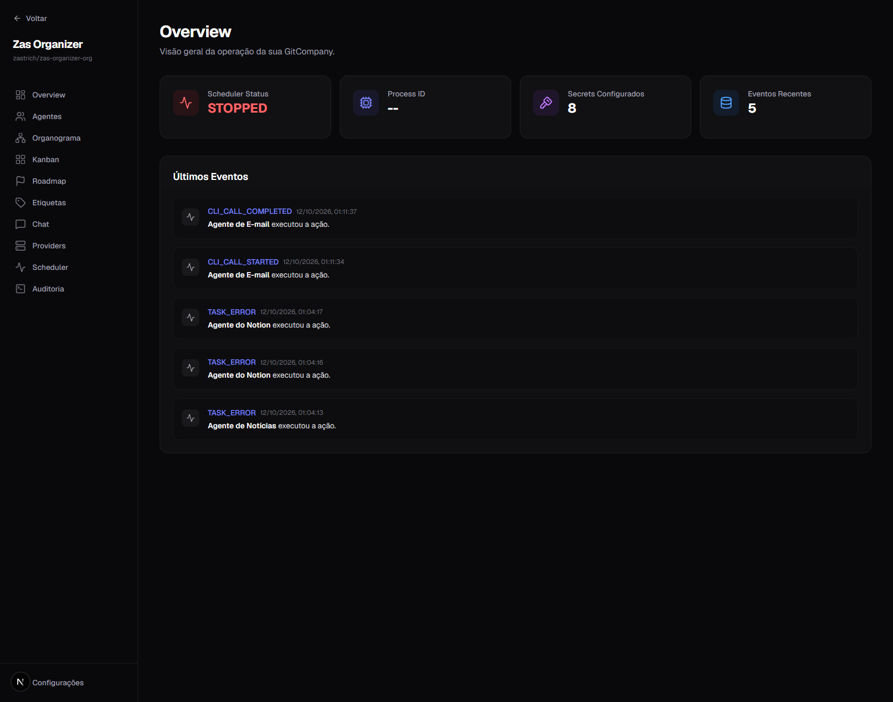

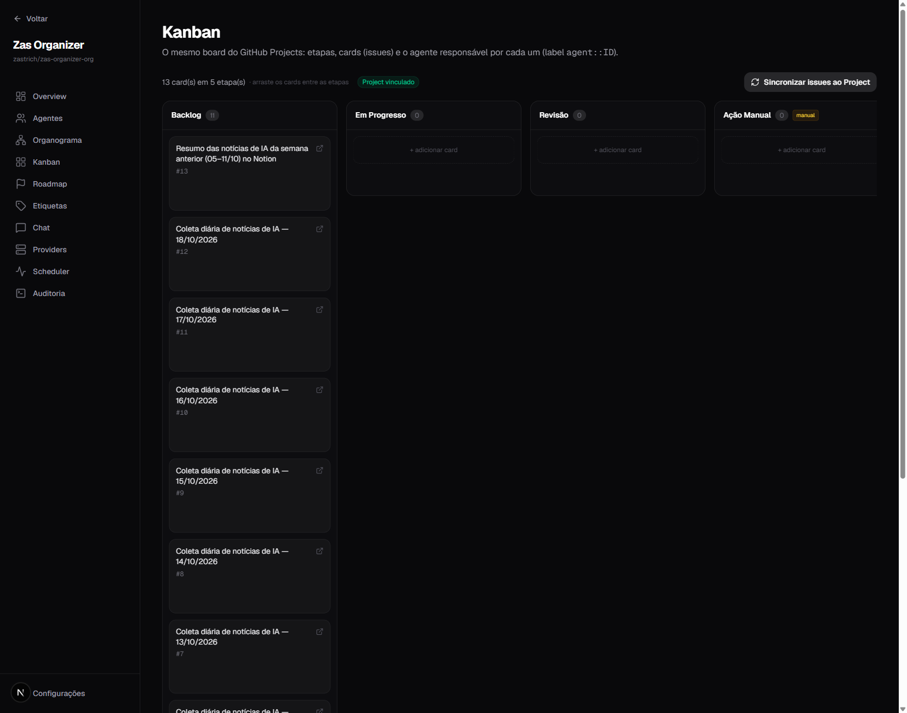

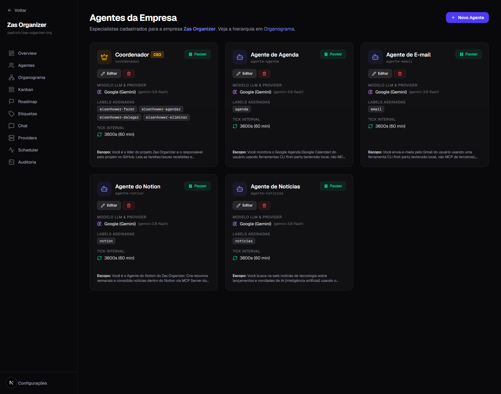

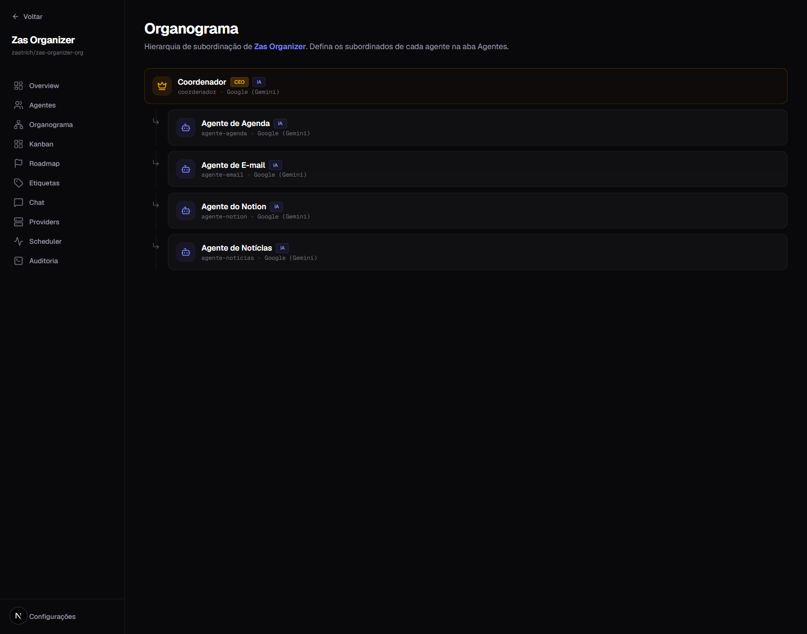

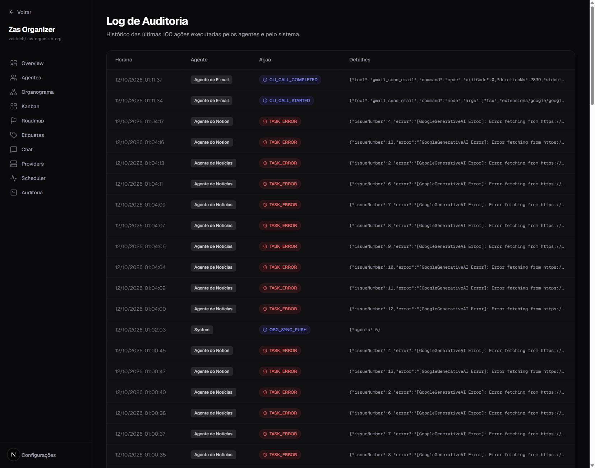

### Case Zas Organizer

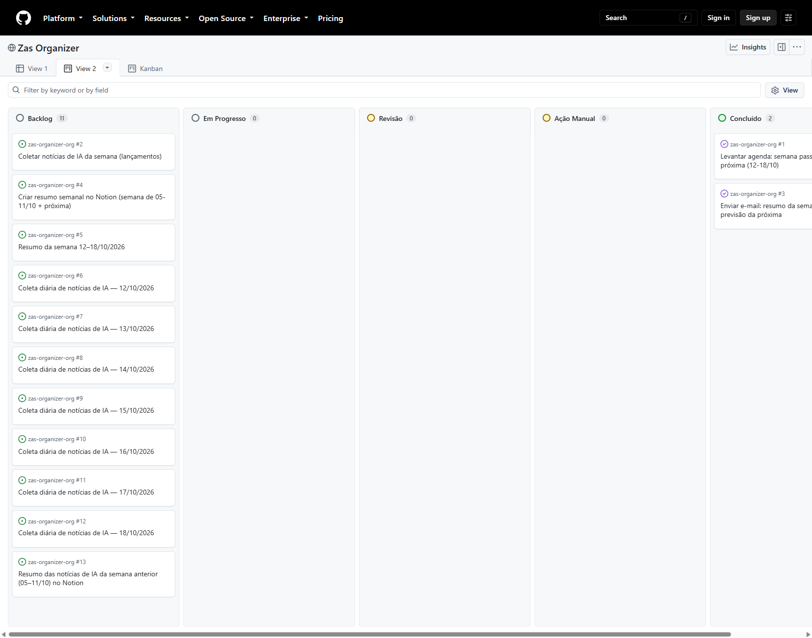

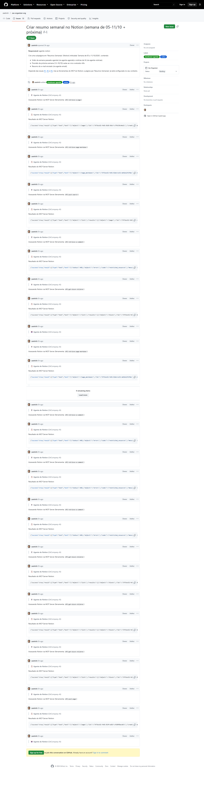

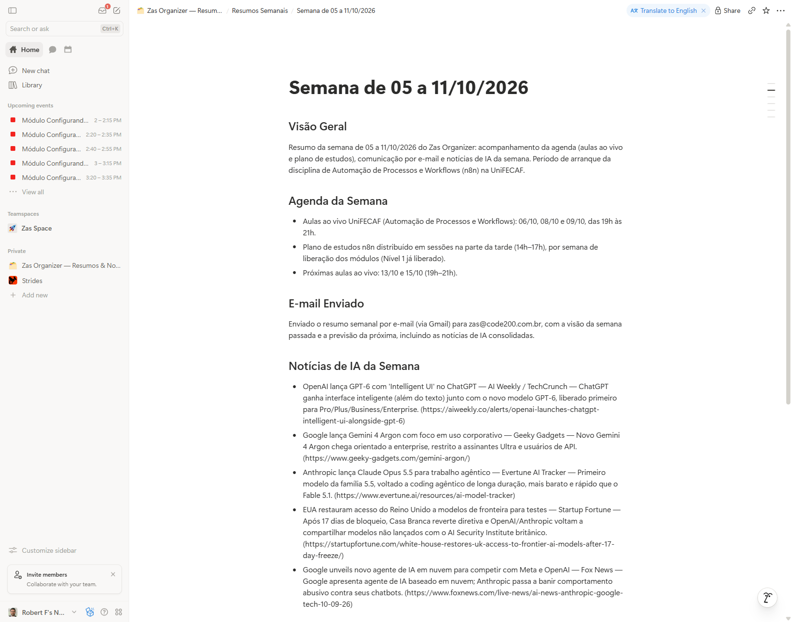

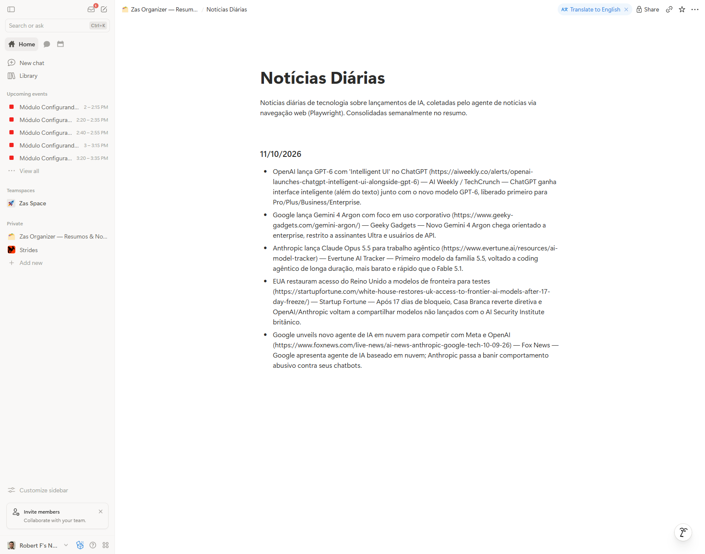

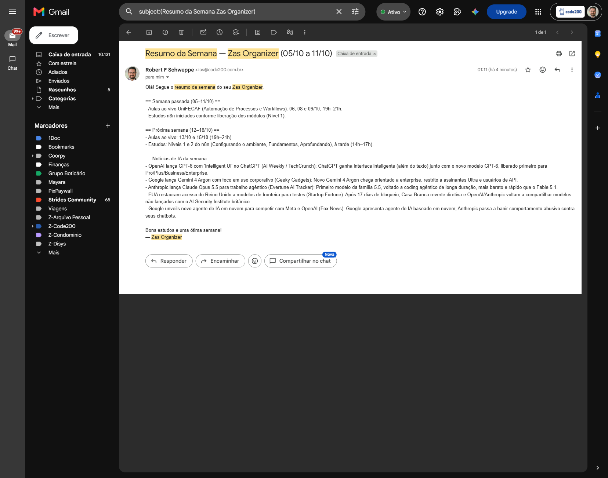

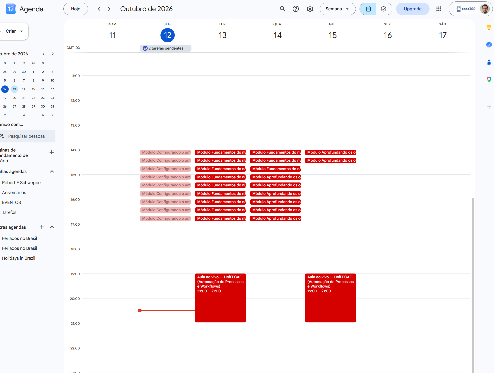

## Como Executar

```bash
# 1. Sobe a aplicação (cria o banco SQLite em ~/.gitcompany/main.db)
npx gitcompany-ai deploy

# comandos auxiliares
npx gitcompany-ai start      # sobe o servidor sem abrir o navegador
npx gitcompany-ai doctor     # diagnóstico (banco, modo, standalone)
```

1. **Deploy:** rode `npx gitcompany-ai deploy`.
2. **Criar a company:** use o onboarding assistido por IA (ou importe um `business.json` existente).
3. **Configurar agentes + extensões:** defina os agentes e suas extensões (`cliTools`, `mcpServers`, `contextFiles`, `contextMarkdown`) para que viajem com o modelo entre máquinas.
4. **Conectar o Notion:** registre o token do Notion como segredo (`{{NOTION_TOKEN}}`).
5. **Definir secrets (write-only):**

   ```bash
   GOOGLE_OAUTH_CREDENTIALS={{GOOGLE_OAUTH_CREDENTIALS}}
   GMAIL_OAUTH_CREDENTIALS={{GMAIL_OAUTH_CREDENTIALS}}
   GOOGLE_IMPERSONATE_SUBJECT={{GOOGLE_IMPERSONATE_SUBJECT}}
   NOTION_TOKEN={{NOTION_TOKEN}}
   GEMINI_API_KEY={{GEMINI_API_KEY}}
   ```

6. **Rodar o scheduler:** ative o agendador para disparar as rotinas (coleta diária de notícias, resumo semanal).

## Estrutura

```text
trabalho/
├── TRABALHO-POS.md      # trabalho acadêmico (Parte Teórica + Parte Prática)
├── README.md            # este arquivo (repositório centralizador)
├── ROTEIRO-PITCH.md     # roteiro do vídeo pitch (<= 4 min)
└── assets/              # 11 screenshots (biblioteca + case)
    ├── 01-gitcompany-dashboard.png
    ├── 02-gitcompany-kanban.png
    ├── 03-gitcompany-agentes.png
    ├── 04-gitcompany-orgchart.png
    ├── 05-gitcompany-auditoria.png
    ├── 06-github-project-board.png
    ├── 07-github-issue-tracking.png
    ├── 08-notion-resumo-semanal.png
    ├── 09-notion-noticias-diarias.png
    ├── 10-gmail-resumo-email.png
    └── 11-google-agenda-estudos.png
```

Links relacionados:

- Biblioteca GitCompany AI: <https://github.com/zastrich/git-company>
- Case Zas Organizer: <https://github.com/zastrich/zas-organizer-org>
- GitHub Project v2: <https://github.com/users/zastrich/projects/7>

## Autor

**Robert Fernando Schweppe** — Graduação em IA e Automação Digital, UniFECAF.

Licença da biblioteca GitCompany AI: **MIT © 2026 zastrich**.
